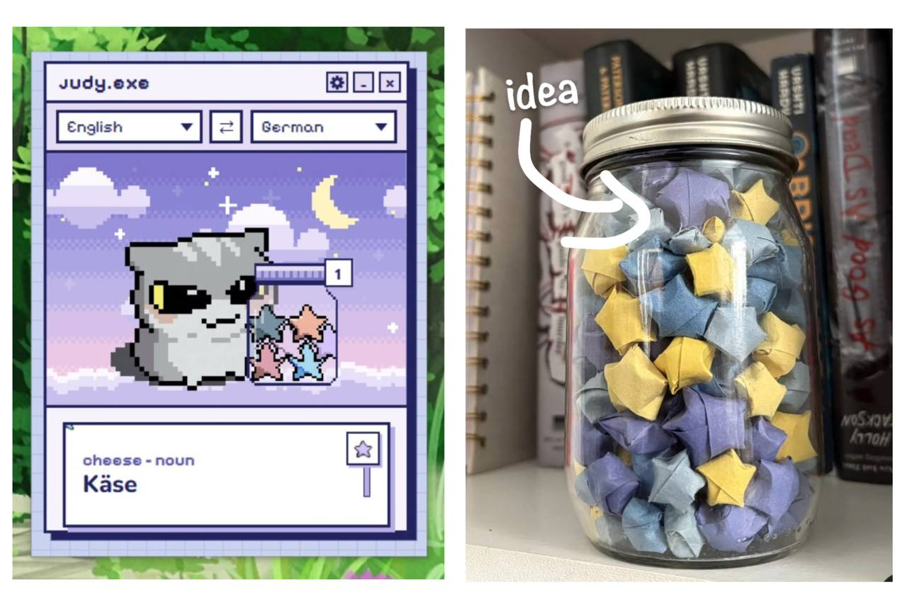

# Judy the Translator

A cute pixel desktop translator. Select text in any app, press a shortcut, and Judy shows the translation right away. Words worth remembering can be saved as stars in a jar.

## Why Judy

No more switching to Google, Google Translate or asking GPT every time an unknown word shows up. The translation appears right where the word is, and saved words stay in the jar for reviewing later.

The jar idea comes from the origami lucky star jars from Japan: a word and its translation are written down, folded into a paper star and dropped into a jar. Judy does the same, digitally.

## Download

Get `Judy.exe` from the [latest release](https://github.com/dialeelova/translator-Judy/releases/latest) and double-click it. No installation needed. Windows 10/11 only.

If Windows shows "Windows protected your PC", click **More info**, then **Run anyway**.

## How it works

| Shortcut | What it does |
| --- | --- |
| `Ctrl + Shift + J` | Translates the selected text |
| `Ctrl + Shift + K` | Drag a box over anything on the screen (images, videos, PDFs, games) and Judy reads and translates it |

1. Choose the "from" and "to" languages at the top.
2. Select a word, or drag a box, and press the shortcut.
3. Press the star to save the word in the jar. Open the jar to browse, review or delete saved words.

## Languages

- **Selected text:** about 130 languages, including Auto-detect.
- **Image scan:** about 90 languages. Pick the language of the text in "from" first, because Auto-detect does not work for images.

## Good to know

- Best for **single words and short phrases**. Longer texts are translated too, but only as a quick look, not as a polished translation.
- A word is translated without its sentence, so words with many meanings can show the wrong one.
- Machine translation can be wrong, especially for smaller languages.
- **An internet connection is required.** The selected text is sent to Google Translate. Image scanning also downloads a small language file the first time each language is used.
- Image scanning works best on clear, large text.
- Windows only for now.
